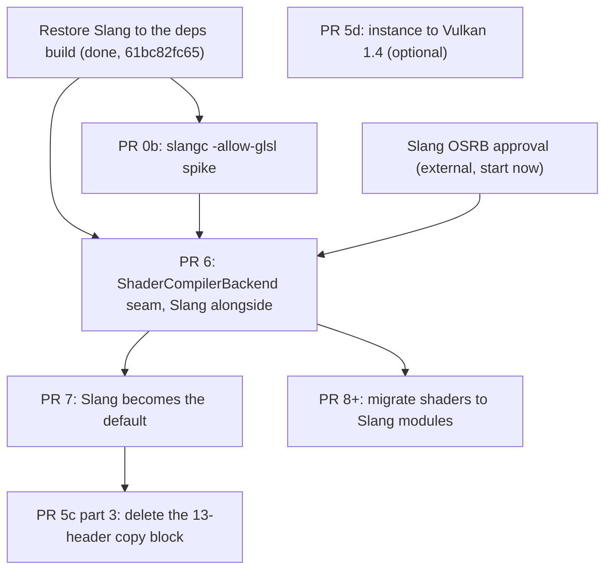

# Remaining work: replacing glslang with Slang

Companion to [.cursor/plans/glslang-to-slang-migration.md](.cursor/plans/glslang-to-slang-migration.md), which keeps the full history and the reasoning behind decisions already taken. This file covers only what is left.

Commit hashes are as of the rebase onto `master` that preceded the PR 895 review and change on every rebase. Find a commit by its subject with `git log --format='%h %s' master..HEAD`; from now on, cite the subject alongside the hash.

## What has already landed

- **PR 0a** - Spiked and kept the SDK bump. The tree builds and runs on Vulkan SDK 1.4.363.0 with glslang 16.6.0. This disproved the plan's central premise: the private headers were never what pinned the SDK, so PRs 3 and 4 do not gate anything except their own cleanup.
- **PR 1** (`183c9fd7e4`) - Replaced byte-exact SPIR-V goldens with `ShaderReflection` text goldens plus `spirv-val`. Nine `.reflect` files. This is the safety net every remaining PR is verified against.
- **PR 2** (`22e8ab86d6`) - Hygiene: deleted `kShaderStageCount`, hardened glslang error-log scraping, collapsed the vestigial multi-set scaffolding, restored the rule of zero on `ShaderReflection`.
- **PR 5a** - Vulkan SDK 1.4.363.0, with Slang meant to be built alongside glslang. As landed, `slang` was missing from the `./vulkansdk` target list, so Slang was not actually in the deps prefix; it was restored afterwards in `61bc82fc65` (Add Slang build), which puts `slangc` and `slang.h` there.
- **PR 5b** (`35c779bebc`) - Retargeted the compiler to Vulkan 1.3 / SPIR-V 1.6, split `VULKAN_API_VERSION` into instance and device-minimum constants, fixed a `VulkanPhysicalDevice` gate that tested 1.2 while chaining 1.3 structs.
- **PR 5c parts 1 and 2** (`acbd16b1f6`) - Deleted the dead `build_info.h` include and swapped glslang's disassembler for the SPIRV-Tools one. The copy block in `scripts/common-functions.sh` is down from 16 files to 14.
- **PR 3** (`c16ae41c47`) - Deleted `TShaderIRUtils` and moved subroutine resolution to a textual pass in `ShaderManager`, run before glslang sees the source. Took the copy block from 14 files to 13.
- **PR 4a** (`8386189a0b`) - Restructured `glslToSpirv` and `buildSpirv` to take a whole material at a time, giving each stage its own `glslang::TProgram` but sharing one I/O resolver between them. Pure plumbing: the resolver is still our stateless `IoMapResolver`, so no behaviour changed and no golden moved.
- **PR 4b** (`03bafb57a2`) - Handed binding and location assignment to `glslang::TDefaultGlslIoResolver`, reducing `ShaderRedecorator` to reflection extraction plus a clash check and deleting the sentinels, the allocator and the SPIR-V patching. Two of the nine goldens moved. Corrected a long-standing bug in which an array of resources was given one binding per element rather than a single binding with a descriptor count.

- **PR 895 review fixes** - See [pr-895-review-followups.md](pr-895-review-followups.md). `5edddf49f3` (Report a later stage's link failure instead of a generic error), `f40ae23ef9` (Accept a push that any stage of the material covers), `c6d95bee06` (Apply all subroutine bindings in one pass so they cannot chain), `ecf3fa5aed` (Do not treat a function prototype as a rebinding target), plus two cleanups: `e0e8d87820` (Correct stale comments about the redecorator and its tests) and `3fe928e579` (Name the reflection artifact .reflect to match the goldens). Each fix has a test that fails without it, and no golden moved.

### Four items taken outside the PR sequence

Each was filed under PR 7 but needs nothing from Slang, and each is better as its own commit than as a line in PR 7's diff: the golden movement stays attributable, and the behaviour is pinned by tests before Slang has to reproduce it. All four have landed.

- **Varying locations** (`8bbb7388ba`) - Rejects an inter-stage varying that arrives without an explicit location, which glslang would otherwise match across stages only by luck of declaration order. Three exemptions were needed and each one rejected real shaders before it was added: vertex inputs and fragment outputs, which are matched against the reflection rather than another stage; built-in members of the implicit `gl_PerVertex` block, which is what made the first attempt reject all five vertex shaders; and blocks carrying one location for the whole block, the form every mesh and task shader uses.
- **`createCache` coverage** (`6ceeabcdb2`) - Pins the empty reflection as the documented contract rather than making the method populate one. Its only caller, `saveArtifacts`, reads just the GLSL and SPIR-V, so a regression would have shown up as missing artifacts rather than a failing test.
- **Array dimensions** (`578855b252`) - `ItemInfo` gained `array_length` and `array_stride`, so element *i* of a buffer member is at `offset + i * array_stride`. See below for the two-dimensional member this turned up.
- **Push constants** (`1bdb9c6ce7`) - Reflected into new `push_constants` and `push_constant_attrs` sections, and every push is now checked against them. See below.

### One cleanup they turned up

- **Deleted the dead `accumulationComposite.frag`** (`1ef9490600`) - Found while reflecting push constants, as a block nothing ever pushes. Its last consumer was `DistributedCompositor::initResources`, so removing distributed mode in `f20941c8ef` deleted the caller and dropped `distributedCompositor.frag` from the manifest but left this one compiling into the shader library with no material to instantiate it. `MultiGpuCompositor` had been its other consumer until `5612fa7547` removed the compositor-side accum texture array in 2021; the live sibling there is the peer variant. Two files, the source and its `ShaderManifest.json` entry, that file being the only thing that decides what enters the library.

  Worth carrying into PR 8's sweeps: the name is a prefix of `accumulationCompositePeer.frag`, so a plain search for it matches the live sibling and it reads as referenced when it is not. Anything that walks the library looking for dead shaders needs a word-boundary match, not a substring one.

## How the remaining pieces depend on each other

What is left is one track, plus one standalone item:

- **Migration track: PRs 0b, 6, 7, 8+.** The actual replacement. Gated at the front by the spike and by OSRB approval.
- **Cleanup tail: PR 5c part 3.** Now the last thing rather than an independent track, because only PR 7 can retire the private headers. See below.
- **Standalone: PR 5d.** Independent of everything, and optional.

The cleanup track no longer exists as a separate thing. It was meant to be PRs 3, 4a and 4b retiring the private headers between them; all three have landed and the headers are still there. PR 3 took one of the thirteen and PR 4b took none, because handing assignment to glslang needs more of `iomapper.h` than subclassing it did, not less.

## PR 0b - Spike slangc's GLSL compatibility mode

**Depends on:** Slang being in the deps build. Unblocked once Slang was restored to it, which installs `slangc` at `$PREFIX/bin/slangc`. (PR 5a was meant to do this and did not; see above.)
**Gates:** the scope of PRs 6, 7 and 8.

Compile the shader corpus through `slangc -allow-glsl` and classify each file three ways: compiles clean, fails on something mechanical and pattern-fixable, or fails on something Slang's GLSL subset does not model (which forces that shader into the PR 8 bucket early).

Two things make the raw-source version of this spike misleading:

- Stage files are not independently compilable. They depend on the `#include` dictionary assembled at runtime by `buildExtensionAndIncludesString` and on the `processOperators` substitutions. Either run over assembled `final_glsl` captured from a real run via the `ShaderArtifactTypeBits` hooks, or treat a raw pass as a lower bound only.
- Report test and non-test counts separately. Of 163 shader sources, **88 live under `Tests/`**, so more than half the corpus is fixtures that can be rewritten or deleted freely. Only the 75 outside `Tests/` are load-bearing. Recount rather than trusting those figures: the test half grows as coverage is added, and the non-test half shrank by one when `accumulationComposite.frag` went.

### Results of the first pass (2026-11-01)

`slangc` 2026.17 from the `vulkan-sdk-1.4.363` build, invoked as `slangc -allow-glsl -lang glsl -target spirv -fvk-use-scalar-layout -matrix-layout-column-major -stage <stage> -entry <entry>`. Compile success only: nothing here checks that Slang's SPIR-V or bindings match glslang's. The harness is [pr0b-slangc-spike.py](pr0b-slangc-spike.py); it is fed to `python3 -` inside the build container and writes under `build_release/pr0b/`.

**Corpus, recounted from the manifests:** 171 entries, 145 stages and 26 includes, plus `Marks/typeDefines.glsl`, which `ShaderManager` generates at runtime and no manifest lists. Of the stages, **56 are production and 89 are under `Tests/`**. The 163/88/75 figures above are stale.

**Method.** Pass A compiles the assembled GLSL captured by running the whole render suite with `OMNISCI_always_save_shader_artifacts=glsl`: 92 files, 68 clean. Pass B assembles every stage the way `Library` and the builder do (header, extensions, deduplicated transitive includes in dependency order) but cannot apply `processOperators`, so it judges only stages without template tags. Three things the harness must reproduce or every result is noise:
- `Library` strips each file's `//<extensions>` and `//<includes>` header blocks and the builder emits the transitive include set once. Compiling the files as written duplicates every nested include.
- `slangc` cannot write to `/dev/null`, and with that as its output reports a failure for files that compiled.
- Entry points are not always `main`: `SMAAEdgeDetection.frag` is built three times, as `SMAALumaEdgeDetection`, `SMAAColorEdgeDetection` and `SMAADepthEdgeDetection`, and compiles clean as all three.

**Production stages (56):**

| Outcome | Stages |
|---|---|
| Verified clean (assembled, compiled) | 18: all PPLL compute, the SMAA passes, the accumulator passes, `MSMultiGpuComposite.comp`, `clearQueryOutputBuffer.comp`, `fullScreenTriangle.vert`, `shadingBase.vert`, `rtShadowsSimple.miss` |
| Not modelled, needs a Slang-native rewrite | 13: every Mark vertex, geometry and mesh template that touches `slabAddressTable.glsl` or declares geometry/mesh I/O, plus `geoCount_build.comp` and `geoCount_count.comp` |
| Mechanical fixes only | 10: the Mark fragment templates, `windBarbTemplate.vert`, the two PolyMark PPLL shaders, `accumulationCompositePeer.frag`, `shadingMain.frag` |
| Not judged: never assembled by the render suite, no known blocker | 15: all six Scales, `mesh2dTemplate.*`, `ppllPolyTemplate_capture.vert` and `_count.vert`, `ppllCountFragments.frag`, `multiGpuCompositeIDs.comp`, `shadingMain.vert`, `tableFunctionTest.*` |

Only 23 of the 56 are assembled by the render suite at all; the rest of the not-modelled and mechanical rows are predicted statically from the root causes below, which is reliable for the not-modelled ones since each is a construct Slang rejects outright. Test stages: 53 verified clean, 14 mechanical, 10 not modelled, 12 not judged.

**Root causes, each confirmed on a minimal shader:**

Not modelled by `-allow-glsl`, with no GLSL-level workaround:
- `layout(buffer_reference)`, buffer device addresses (`E31217`). The decisive one: `Marks/slabAddressTable.glsl` uses it, and five of the seven Mark vertex-stage templates include it (all but `mesh2dTemplate.vert` and `windBarbTemplate.vert`), as do the two mesh templates. Both `geoCount` passes use it directly. Slang's own pointer types are the replacement, which means those shaders are Slang source, not GLSL.
- Geometry shader primitive layouts, `layout(lines_adjacency) in` and `layout(triangle_strip, max_vertices = N) out` (`E31217`). Four production geometry shaders.
- Mesh shader output layout, `layout(triangles, max_vertices, max_primitives) out` (`E31217`), and `taskPayloadSharedEXT` (`E20001`). Two production mesh shaders.
- `layout(pixel_interlock_ordered) in` (`E31217`). Tests only.

Mechanical, each workaround verified to compile:
- `layout(location)` on members of an interface block (`E31201`). Every Mark interface block is generated this way by `GlslStructBuilder`, so this is one change in one place, but it reaches all 17 Mark stages. A block-level location or loose varyings both compile. Note PR 4b made per-member locations load-bearing, and the varying check in `GlslangWrapper.cpp` already exempts blocks carrying one location for the whole block.
- `layout(offset = N)` on a push constant member (`E31201`, `E20016`). Replaceable by padding members, but that changes what the reflection's span rule sees, since the span would then start at 0. PolyMark's split block is the production case.
- `imageAtomic*` on a `coherent` image (`E30048`). Compiles without `coherent`; `restrict` is fine. Needs a semantic check before dropping it. Two production shaders.
- `vec4(color, kS)` with `kS` a `vec3` in `PBRShading/shading.glsl` (`E30019`). GLSL takes `kS.x`; Slang refuses. `kS` is only ever accumulated from scalars and is described as a density estimate, so `float kS = 0.0;` is behaviour-preserving and worth doing on its own.
- A user identifier named `imageSize`, which Slang finds ambiguous with the builtin (`E39999`). Tests only.

**What this means for scoping.** The production shaders split cleanly by family. Compute, post-processing, PPLL and shading are near-clean under `-allow-glsl` and can ride PR 6 with a handful of mechanical edits. The Marks cannot: BDA and geometry/mesh I/O put most Mark vertex templates and every Mark geometry and mesh template into the PR 8 bucket from the start, and the Marks are the core of the renderer. PR 6's flag therefore cannot be all-or-nothing; it has to select per family, or the Marks have to be rewritten before Slang can be the default.

### Second pass: be-render-tests and reflection parity (2026-11-01)

The server ran in the build container with `OMNISCI_shader_artifact_path` set and `OMNISCI_always_save_shader_artifacts=all`, against the existing render-test data store (`/home/seves/render-tests`), and the `be-render-tests` suite ran from the host (`test.sh`, Node 24.11.0): 441 passing, 7 pending, 2 failing. The two failures are `subquery_hittest_tests_7` and `_8`, which the suite's local `DO NOT LAND YET` commit re-enables ahead of the optimization branch, so they are not shader-related. [pr0b-slangc-parity.py](pr0b-slangc-parity.py) then compiled every captured stage, using the `.builder` for its entry point, and compared `spirv-cross --reflect` of glslang's SPIR-V with Slang's after normalising Slang's names (`SLANG_ParameterGroup_<block>_std430`, `entryPointParam_<entry>.<output>`).

**Correct flag: `-matrix-layout-row-major`, not column-major.** Slang names matrix layouts the other way round from GLSL. With `-matrix-layout-column-major`, every `mat3x2` and `dmat3x2` in a block got a 16 or 32 byte column stride instead of 8 or 16, shifting every later member. With `-matrix-layout-row-major` the layouts match glslang exactly. The first pass's compile results do not depend on this.

**Coverage.** 39 distinct stages captured; the suite reached `mesh2dTemplate.*`, `ppllCountFragments.frag`, `ppllPolyTemplate_capture.vert` and `ppllPolyTemplate_count.vert`, and all six Scales are spliced into Mark shaders rather than being stages of their own. Artifacts are named by template basename, so each compile of a template overwrites the last and only one variant per template survives. That is why ordinal, quantize and percentage scales, which the suite uses heavily, appear in no captured file. Getting every variant needs the artifact name to be made unique per compile. Still unreached by anything: `windBarbTemplate.*` (the suite has no windbarb test), `multiGpuCompositeIDs.comp` (needs more than one GPU), `accumulationCompositePeer.frag`, `shadingMain.vert` and `tableFunctionTest.*`.

**Compile results.** 20 of the 39 compile. The 19 failures are all Mark stages and both `geoCount` passes, and every one fails for a root cause the first pass predicted, with one addition: `gl_DrawIDARB` (`ARB_shader_draw_parameters`) is unknown to Slang, which needs the core `gl_DrawID`. Renaming it makes `ppllPolyTemplate_capture.vert` compile.

**Reflection parity, for the 20 that compile.** 9 match glslang exactly. The other 11 differ in three ways, none of them a layout difference:
- Auto-assigned bindings are renumbered (5 stages: the three SMAA passes, `mesh2dTemplate.frag`, `ppllCountFragments.frag`). glslang numbers them across a material's stages with one shared resolver; Slang, given one stage, starts again at 0. Every explicit binding matched. Expected to go away when Slang compiles the composed program, which is PR 7's plan.
- An array member of a block becomes a struct holding a `data` array (5 stages). Offsets, strides and sizes are identical; only the names change, to `tiles.data.x` instead of `tiles.x`. `ShaderReflection`'s flattening has to unwrap this in PR 7, or every name `Material` and the Vega writers look up stops resolving.
- Unused resources are dropped (3 stages). glslang keeps every declared resource; Slang keeps only what the entry point reaches, and `-preserve-params` does not change that. For `SMAAEdgeDetection.frag` (`fTexCoord`) and `mesh2dTemplate.vert` (`SHARED_VIEWPORT_UBO`) the resource really is unused. Anything that binds or pushes by name to such a resource would now fail to find it.

**Two silent miscompiles, found by reading the output.** Neither is reported as an error:
- **`texelFetch` on a `sampler2DMS` drops the sample index.** `SeparateMultiSample.frag`'s `texelFetch(colorTex, coord, int(pushConstants.sampleIndex))` comes out as `texelFetch(colorTex, coord, 0)`, so the push constant disappears from the module too. That is a Slang bug in its GLSL front end, and it would make every multisample separation pass read sample 0.
- **Unsuffixed double literals are narrowed to float.** `SEPARATOR_DOUBLE` in `coordConvertSubroutines.glsl` and the Mercator polynomial that `QueryRenderer/Projections/Projection.cpp` emits into shaders write `double` constants without `LF`. glslang keeps them at full precision; Slang treats them as `float`, warning `E40009` or `E40010`, so `SEPARATOR_DOUBLE` becomes -infinity and the small polynomial coefficients in `ppllPolyTemplate_capture.vert` become zero. Adding `LF` is mechanical and harmless under glslang, so it can land now.

**What this changes.** The not-modelled and mechanical lists from the first pass stand, plus `gl_DrawIDARB` and the double literals in the mechanical one. Compile success is not enough: PR 6 has to diff the SPIR-V or the rendered output for every family it moves, because the multisample bug compiles clean and the literal narrowing only warns. The `texelFetch` bug should be reported upstream, with `SeparateMultiSample.frag` as the reproducer.

**What is left of PR 0b:** making artifact names unique per compile and rerunning, to see every scale variant; and a windbarb spec, since nothing renders one. Both are optional now: neither can change which families compile, because every unreached stage is a Mark template that already fails on BDA or geometry I/O, or is a variant of one that compiles.

## What PR 3 established, which the rest inherits

Two findings from landing it change how later PRs should be scoped.

**The assembled source does not contain its includes.** `buildExtensionAndIncludesString` emits `#include` directives, because `Library` wraps each dictionary entry as `"#include \"...\""`, and `GlslangIncluder` resolves them during parse. So `final_glsl` names its includes without holding their text. The subroutine pass has to look targets up through the Library, since the colour conversion subroutines are defined only in an included file. Any backend that replaces glslang inherits this: it needs its own answer for the include dictionary, not just for the assembled string.

**Textual inspection of the shader library has to survive the preprocessor.** `quantitativeScaleTemplate.vert` selects the type of a function's last parameter with an `#if`, and in one case leaves the body on the far side of the `#endif`. Neither a parameter-list pattern nor brace-matching can classify those definitions; what works is that a declaration names its return type immediately before the function name. Telling a definition from a prototype then takes one more step, added after the PR 895 review: the first `{` or `;` after the `(` decides it, skipping comments and preprocessor lines. Worth remembering before writing any further pass over GLSL text.

## What PR 4a established, which PR 4b builds on

The original plan for PR 4 was to link every stage of a material into one `glslang::TProgram` and call the public `mapIO(nullptr, nullptr)`. Both halves of that were wrong, and reading glslang 16.6.0's `iomapper.cpp` and `ShaderLang.cpp` is what settled it.

**One `TProgram` cannot span a material's stages.** A material may hold two shaders of the same stage, and `RaytracingTest` does it twice: `InstancingTest` pairs `Instancing.miss` with the shared `Shading/rtShadowsSimple.miss`, and `BlasMultiMesh` does the same. A program has room for one intermediate per stage, so linking those together would merge both miss shaders and return the same module for both caches, if it linked at all with two `main` bodies in one stage. PR 4a therefore gives each stage its own program.

**A null resolver does not give you a program-wide one.** `TIoMapper::addStage` constructs its `TDefaultIoResolver` as a stage-local, so `mapIO(nullptr, nullptr)` allocates bindings independently per stage, which is the collision PR 4 exists to prevent. Pairing a null resolver with `TGlslIoMapper` is worse: `TProgram::mapIO` forwards the raw pointer to `doMap`, which dereferences it on its first line.

**Sharing the resolver is what actually delivers cross-stage coherence.** `TDefaultGlslIoResolver` keeps its slot maps in the resolver rather than the program, and none of `beginResolve`, `endResolve`, `beginCollect` or `endCollect` clears them; all four only track which stage is current. One instance reused across sequential per-stage `mapIO` calls accumulates bindings by name exactly as a single program would. PR 4a put that sharing in place with our existing stateless `IoMapResolver`, so PR 4b is only a swap.

**Lifetime constraint that swap must respect.** A stateful resolver remembers names in a `TString`, which belongs to the pool of whichever `TProgram` was current when it was recorded, and that pool dies with its program. `glslToSpirv` holds all the shaders and programs for the whole call and declares the resolver after the programs so that it is destroyed first. Do not reorder those declarations.

## What PR 4b established, which PR 7 inherits

Four findings, three of them constraints on anything that touches this code again.

**glslang is built without RTTI, so none of its classes can be subclassed.** The typeinfo a derived class's own typeinfo refers to was never emitted, and the link fails with `undefined reference to typeinfo for glslang::TDefaultGlslIoResolver` on every target. The tell is that *constructing* the class links fine: the vtable is there, only the typeinfo is missing. The pre-4b `IoMapResolver` got away with deriving from `TIoMapResolver` only because that class is pure-abstract with no out-of-line virtual to anchor its typeinfo, so the compiler emits it weakly on our side. `IoMapResolver` therefore holds a `TDefaultGlslIoResolver` and forwards nineteen methods to it. **Check this first if PR 6 finds itself wanting to subclass anything in Slang.**

**An array of resources is one binding, not one per element.** `ShaderRedecorator` had always claimed a binding per element, so arrays left gaps after them. `VulkanMaterial` has meanwhile always built a single `VkDescriptorSetLayoutBinding` with `descriptorCount` set to the array size, so the runtime only ever used the first binding of each array and the rest were silently wasted. glslang assigns the Vulkan way, which is what surfaced it: `numBindings` in `TDefaultGlslIoResolver::resolveBinding` is the cumulative array size only when the target is OpenGL. The array size still belongs in the reflection, which is where the descriptor count comes from; it just has nothing to do with occupancy.

**Inter-stage varyings must declare explicit locations, and blocks must declare them per member.** Both are already true of the whole shader library, and both are now load-bearing. A block whose members carry locations must not also get one on the block variable, which is why `IoMapResolver::resolveInOutLocation` declines to assign to structs; glslang only skips blocks whose first member is a built-in, and the Vulkan path in `TDefaultIoResolverBase` behaves the same way. Separately, glslang's own comment on that Vulkan path is that it "does not do proper cross-stage lining up", so a varying *without* an explicit location would be matched across stages only by luck of declaration order. That is now rejected; see the varying-locations item (`8bbb7388ba`) above.

**glslang assigns only to resources it considers live.** `resolveBinding` auto-assigns when `ent.live && doAutoBindingMapping()`, and the shader library routinely declares resources a given stage never reads. Since `ShaderReflection` is what `VulkanMaterial` binds descriptors from, an unassigned resource is both missing from the reflection and liable to collide, every unassigned one defaulting to binding zero. `IoMapResolver` forces the liveness flag, restoring the one behaviour the old resolver had that glslang's does not. This is the only liveness gate that matters; `resolveInOutLocation` has none.

Two things stayed true as planned. Clash detection could not be delegated: `reserveSlot` explicitly "tolerate[s] aliasing, by not double-recording aliases", and the only clash glslang reports is one name carrying different explicit bindings across stages, which is the opposite of what `ShaderRedecoratorClashTest` exercises. And `setShiftUboBinding` and friends remain a dead end, since `resolveBinding` adds the shift base to explicitly declared bindings too.

Only two of the nine goldens moved, rather than all of them as predicted, because most of the corpus binds explicitly. PR 4b also left `createCache` unverified, its one live caller `saveArtifacts` passing `nullptr` as the redecorator; `6ceeabcdb2` has since covered it, pinning the empty reflection as the contract `ShaderManager.h` already documented.

## What the four non-Slang items established, which PR 7 inherits

All four are reflection behaviour, so PR 7 has to reproduce them from Slang rather than inherit them. The tests pin each one, so PR 7 will find out quickly, but the reimplementation surface is larger than PR 7's section below originally claimed.

**There is a live two-dimensional array member, and nothing had ever reflected it.** `PPLL_BATCH_STAT_COUNTERS_SSBO` declares `PPLLFragmentStats batch_stats[maxNumBatches][numTiles]`. The array-dimension work initially rejected multi-dimensional members with a `CHECK`, on the assumption that `slabs[64]` was the only array case; `QueryRendererTest` aborted on the first run. It is now flattened to total element count and element stride, which is how `PPLLRender` actually consumes it: the buffer is read back into one flat `std::vector<PPLLFragmentStats>` and indexed linearly. Flattening is only valid if the dimensions are tightly packed, so the exact division is checked. Two further cases are rejected because each would be a silently wrong number: a dimension given by a specialization constant, which SPIRV-Cross stores as that constant's id rather than its value, and a runtime-sized array with inner dimensions, which has no element count to divide by.

**SPIRV-Cross names a push constant block after its variable and a uniform block after its type.** This asymmetry cost a round trip. Reasoning from the uniform case is what produces the wrong answer: a `.reflect` file says `SLAB_ADDRESS_TABLE_UBO` rather than `slab_address_table`, so the type name looks like the universal rule, but `push_constant_buffers` entries carry the instance name instead. Both names are now recorded, since no call site should have to know which one a category reports, and either may be absent - a block declared without an instance name has no variable name, and an empty one must not be recorded or a lookup on `""` would succeed.

**A push constant block's range is its members' span, not its declared size.** The declared size always starts at zero, however the first member is offset. The fragment half of `PolyMark`'s split block begins at 4, and 4 is what the call site declares, so the span is the only definition that matches the hand-written ranges. Only the test shader covers this: both goldens that have push constants hold a single member at offset 0.

**`setPushConstants`'s `name` parameter was dead.** It was threaded through `CommandList`, the command struct and the executor, then dropped at `vkCmdPushConstants`. It is now the key into the reflection, and the pushed range must fall inside whatever it resolves to. Five call sites passed prose that could never resolve and now name the block or the member they cover. Stage bits are deliberately not checked, since the stage mask must match the pipeline layout and Vulkan enforces that itself.

## PR 5c part 3 - Delete the header copy block

**Depends on:** PR 7. This was expected to depend on PR 4b alone, and does not.

`GlslangWrapper.cpp` is the only consumer of all 13 copies. It includes just `iomapper.h` and `LiveTraverser.h` directly and reaches the other eleven through them, so whatever retires those two includes retires the lot at once.

PR 4b was supposed to be that, by removing the `TIoMapResolver` subclass. It had the opposite effect: `IoMapResolver` now needs `TGlslIoMapper` and `TDefaultGlslIoResolver` by name, and both are declared only in the private `iomapper.h`. The public `ShaderLang.h` has `TIoMapResolver`, and 16.6.0 did promote `TVarEntryInfo` into it, which is what made this look tractable, but it declares neither mapper nor any concrete resolver. The only concrete resolver in the private header is the OpenGL one; the Vulkan `TDefaultIoResolver` is defined inside `iomapper.cpp` and is unreachable by design, which is why `mapIO(nullptr, nullptr)` has to construct it internally.

So the headers survive until glslang itself goes, in PR 7. In `install_vulkan` in `scripts/common-functions.sh`, delete the `\cp source/glslang/...` lines that follow the `# also add these non-default glslang headers` comment, that comment, and the two `mkdir -p ${ARCH}/include/glslang/...` guards with the comment above them. Find them by content: the Slang restoration shifts the line numbers, and the pin comment above `VULKAN_VERSION` that an earlier version of this plan also said to delete is already gone.

PR 3 was expected to take three of these and took one, `Include/InfoSink.h`. The rest survived because `LiveTraverser.h`, which PR 0a gave `GlslangWrapper.cpp` a direct include of, pulls in `Common.h`, `reflection.h`, `localintermediate.h` and `gl_types.h`, with `intermediate.h` and the rest of `Include/` behind those.

Unlike the two copies dropped in part 2, these 13 genuinely are not installed by glslang, so removing them really will take them out of the prefix. **Verify with a full deps rebuild**; the headers are already in the prefix, so an incremental build will mask the failure.

## PR 5d - Raise the instance to Vulkan 1.4 (optional)

**Depends on:** nothing. **Nothing depends on it.**

A one-line change to `kVulkanInstanceApiVersion`, plus `kMinVulkanDeviceApiVersion` if the device floor should move with it. Confirmed to have no technical upside:

- Vulkan 1.4 also tops out at SPIR-V 1.6, which PR 5b already targets.
- Nothing 1.4 promotes to core is used anywhere in the tree.
- It raises the NVIDIA driver floor from the enforced 535 (`VulkanPlatform.cpp:556`) to roughly R570.

Take it only if something else comes to need 1.4, and confirm the supported-driver matrix first.

## PR 6 - Introduce a compiler backend seam, add Slang alongside glslang

**Detailed plan:** [pr6-shader-compiler-backend.md](pr6-shader-compiler-backend.md), written after PR 0b. It supersedes the sketch below where they differ, chiefly in selecting the backend per material rather than for the whole library.

**Depends on:** PR 0b for scoping, and Slang OSRB approval to merge (not to develop).
**Required by:** PRs 7 and 8+.

Purely additive. `ShaderManager.h:315` holds a concrete `GlslangWrapperUqPtr glslang_wrapper_`. Introduce a `ShaderCompilerBackend` interface covering compile and reflect, add a Slang implementation selectable by flag, keep glslang the default. Map `GlslangIncluder` onto a Slang `ISlangFileSystem` over `Library`. Nothing changes for existing callers.

That file system is not optional detail: per the PR 3 findings above, the assembled source carries `#include` directives rather than their text, so a Slang backend without it sees shaders whose functions are largely undefined.

## PR 7 - Switch the default to Slang, delete ShaderRedecorator

**Landed (2026-11-02), with one deviation: `ShaderRedecorator` stays.** Reflection comes from Slang's program layout (`SlangReflection`), which has the resources Slang's SPIR-V drops, and each stage is also read from its SPIR-V by `ShaderRedecorator`. The two must agree, and the SPIR-V supplies what Slang's reflection API gets wrong: buffer layout under std430/std140, and push constant offsets under `[[vk::offset]]`. The commits:

- `e7839a8a18` - The inline-shader reflection tests compare against goldens under `Tests/RenderTests/ShaderCompiler/Inline/Results`, written from glslang while both compilers were built, rather than against glslang live.
- `d410316913` - The explicit-location check is replaced by matching each stage's inputs against the previous stage's outputs, from the SPIR-V, by location and type (an output may be a wider vector). Slang cannot tell an explicit location from one it assigned, so this is the form that survives. The exemptions carry over: built-ins are skipped, as are the per-vertex arrays of geometry inputs and mesh outputs, and vertex inputs and fragment outputs are not cross-stage. It checks real pairs across vertex, geometry, mesh and fragment stages in the render suite and be-render-tests, with no false positives.
- `9eaa579489` - glslang removed: `GlslangWrapper`, `ResourceLimits` and `SerializationTest`, `ShaderCompilerBackendType` and `setCompilerBackend`, `ENABLE_SLANG` and `HAVE_SLANG`. A rendering build requires Slang. `FindGlslang` became `FindSpirvTools`. Every golden regenerates from Slang unchanged. The one test difference: an unlocated vertex input gets location 2 from Slang where glslang gave 0.
- `9e73df6744` - The glslang side of every `__SLANG__` conditional in the shaders, and the Mark code that filled the geometry stage's GLSL interface tags, which no template had any more. The GfxWSI sandboxes, which only filled those tags, now fill the Slang structs; they are built only with a display, so that change is uncompiled.

The seven behaviours below were all reproduced, and the tests pinning them pass. Two follow-ups from this section have since landed:

- `de56749657` - The PR 895 limitation is gone under Slang: `SlangLaterExplicitBindingTest` binds a sampler explicitly to 0 in a later stage only, and the earlier stage's unbound block is placed elsewhere.
- `337932d39c`, `d68e75674c` - Push constant ranges are derived from reflection (`Material::getPushConstantRanges`), one per stage over its block's span, and all the hand-written ranges and the parameters that carried them are gone. A comparison across both test suites before the switch found every pipeline either matching or over-declared. One dependency had hidden behind the over-declaration: PolyMark's composite pipeline never had its tile index pushed, reading the capture pipeline's through layouts made compatible by one shared range set, and its second pass, after a flush, read it undefined. It is now pushed before each composite dispatch.

### Debug build with validation layers (2026-11-02)

Every earlier run was Release, which does not enable the validation layers. The first Debug run of the render suite failed ten tests, all on validation errors that Release builds never see. Three came from Slang's SPIR-V differing from glslang's, and one bug predated the migration:

- `c604d3c9c5` - Slang compiles `discard` to `OpDemoteToHelperInvocation`, not `OpKill`, which needs `shaderDemoteToHelperInvocation`. It is core in Vulkan 1.3, the device floor, and is now required and enabled. This failed every shader module with a `discard`: all six QueryRendererTest cases.
- `1d2df2e798` - Without `vertexPipelineStoresAndAtomics`, a vertex stage's storage buffers must be `NonWritable` unless the layer can see they are never written. glslang's SPIR-V passed that analysis, but Slang's did not, for three buffers that are only read. What in Slang's output makes them look written was not pinned down. They are now declared `readonly`; generated buffers already were.
- `41cda2309a` - Predates Slang. `VulkanMaterial` sized its descriptor pool at one descriptor per binding, ignoring arrays, so `CanUpdateDescriptors` allocated 6 samplers from a pool of 3.
- `1bb710e9fe` - Found by Debug be-render-tests. Slang guesses an unformatted image's SPIR-V format from its element type, so `usampler2D` became `Rgba32ui`, which mismatched the accumulation ID pass's `R32_UINT` views: undefined reads that rendered correctly by luck. `DefaultImageFormatUnknown` restores `Unknown`, pinned by `SlangSampledImageFormatTest`.

After these, the Debug render suite and Debug be-render-tests (441 passing, the two known failures) run with no validation messages at all. **Lesson for later work: run a Debug build with the layers before calling a compiler change done.** Release passing said nothing about any of these.

The original plan follows.

**Depends on:** PR 6. Smaller now that PR 4b has reduced `ShaderRedecorator` to reflection extraction plus a clash check.
**Required by:** PR 5c part 3, which only this can unblock.

Slang assigns descriptor sets and bindings across a composed program with multiple entry points and reports them through reflection, so the remaining reflection extraction and `ResourceLimits` / `TBuiltInResource` go away rather than being ported. PR 4b already removed the SPIRV-Cross patching via `get_binary_offset_for_decoration`. This also closes the never-completed TODO in `GlslangWrapper.cpp` about sourcing limits from the device, since limit validation moves to the driver.

Keep `ShaderReflection` unchanged and populate it from Slang reflection. Seven behaviours need deliberate reimplementation, four of them newly pinned by the non-Slang commits rather than merely desirable:

- Clash diagnostics quality from `recordBinding`, which is all that is left of the old allocator and still carries the message `ShaderRedecoratorClashTest` pins.
- The struct-flattening naming convention: the block in `reflect_buffers` and the rule stated with it. Dotted names for nested UBO members, bare names for SSBO members, depended on verbatim by `Material` and the Vega property writers.
- `validate_buffer_attr_type`, which whitelists only scalar int/uint/int64/uint64/float/double. Decide whether to carry the restriction forward.
- **Array dimensions**, now `array_length` and `array_stride` on `ItemInfo`. The flattening rule for multi-dimensional members and the three cases it rejects are described above and asserted by `ShaderRedecoratorTest`.
- **Push constant reflection**, now `push_constants` and `push_constant_attrs`. The span rule, the dual naming and the anonymous-block case are all asserted.
- **The push range check** in `Material::validatePushConstantRange`, which every `setPushConstants` call now goes through. Whatever replaces the reflection has to keep resolving a name to a block or a member, or every push in the tree throws.
- **Explicit varying locations**, rejected in `GlslangWrapper.cpp` rather than in the redecorator, so this one moves with the backend rather than with `ShaderRedecorator`. Its three exemptions are the part to preserve; each was arrived at by a shader failing.

One limitation PR 7 should confirm Slang removes rather than assume it does, found in the PR 895 review: stages are resolved one after another, so a binding auto-assigned in an earlier stage can take a number that a later stage declares explicitly for a different resource. `recordBinding`'s clash check catches it, and the old allocator had the same limitation, so it is not a regression. Slang resolving the composed program at once should remove it; check with a test that declares the explicit binding only in the later stage.

Two things that were on this list are no longer: the array-dimension gap and push constants both landed separately, so their golden movement is already absorbed rather than arriving inside PR 7's diff.

A better end state exists for push constants than what landed, and PR 7 is where it belongs: derive the ranges from reflection at pipeline creation and delete the nine hand-written ones. They reach a pipeline three different ways, by `setPushConstantRanges` on a descriptor, as an argument to `createComputePipeline`, and as one to the graphics and raytracing creators, so search for `PushConstantRange` rather than for any one of those. That is the version where the shader and the range cannot disagree at all, rather than one where disagreement is caught at the push. It was not done now because it is a change to pipeline creation, not to reflection.

Hard constraint carried over from PR 1: the shader library declares its uniform blocks `layout(std430)`, legal only because `uniformBufferStandardLayout` and `scalarBlockLayout` are hard device requirements. Slang needs the equivalent of `-fvk-use-scalar-layout` or per-block layout attributes rather than its defaults, or `spirv-val` will reject the output.

## PR 8+ - Migrate shader sources to Slang modules and generics

**Depends on:** PR 6 for the flag. Supersedes PR 3's textual subroutine pass.

Largest effort, biggest payoff, safely deferrable. Slang interfaces plus generics with link-time specialization replace both the subroutine mechanism and the string-splicing `Builder` that is the root source of this subsystem's complexity. Migrate per-shader or per-family behind the PR 6 flag rather than as a flag day.

### Spike findings (2026-11-02): modules alone do not make compiles faster

A spike, kept on branch `simoneves_pr8_spike` (two commits on `master` holding only `spikes/pr8/`, with the code, the timing program and the write-up in `spikes/pr8/README.md`), moved the two quantitative scales spliced into the fastSymbol vertex stage into a generic Slang module. The mechanism works, but the expected compile-time payoff does not follow from it.

- **Coexistence needs no flag.** The PR 6 flag is gone, and is not needed: a GLSL-syntax shader compiled the server's way can `import` a Slang module and call its generics, so a template can stay GLSL and import whatever has moved.
- **Generics replace the subroutine retargeting.** The transform, null check and interpolation become interface type arguments. Converting between generic floating-point types needs `__realCast`. Integer domains, colour interpolation, the accumulation path, and rendering equivalence were not covered.
- **Reflection need not change.** With each scale's uniform block left in the material's shader as today and only the logic in the module, reflection was identical, so `Material` and the Vega property writers are unaffected.
- **Compile time barely moves.** Per compile, in one persistent session: spliced 29.7 ms, generic module 30.9 ms, a concrete module function 26.0 ms, no scale at all 23.5 ms. The scales were 6 ms of 30; the rest is semantic checking of the material's own body, which differs per material. An earlier note here expected about two-thirds of the per-material cost to become a one-off once shared code was in modules; that was wrong, because the two-thirds is checking the body, not the shared code.
- **Modules need a persistent session.** A module costs about 30 ms to load per session, so with `SlangBackend`'s session per material the module variant cost twice today's. Keeping one session across materials needs thought about module names, memory growth, and resetting when the Library is replaced.

So the compile-time case for PR 8 rests on whole templates, not shared pieces: compile each template once as a module, and express everything that varies per material as generic parameters rather than text.

### Follow-up spike (2026-11-02): whole templates as modules halve the cost

The follow-up, the second commit on the same branch, ported the point Mark's whole vertex stage to a generic module, `pointVertex`, with each material reduced to glue: its declarations exactly as today, two small structs implementing `IPointProperties` and `IProjection` against them, and a `main` calling the module. The captured material's reflection was identical to the spliced shader's, and a second kind of point material (no key, size per vertex, unprojected) used the same module.

Per compile, in one session: spliced as today 16.8 ms; module, captured material 8.3 ms; module, second material 6.7 ms. Loading the module costs about 10 ms once per session; with a session per material, as now, there is no gain. So whole templates as modules roughly halve the per-material cost. Across be-render-tests' first-time compiles, about 21 s after the in-memory cache, that would be roughly half again, if the larger templates behave like this one.

Caveats: rendering equivalence was not checked; the module version's SPIR-V is larger (8.4 against 6.9 KB, interface methods left as functions at `-O0`), so pipeline creation time should be checked; slab-read properties, scales, accumulation and row IDs were not covered.

What PR 8 proper has to settle:
- **A persistent session in `SlangBackend`**: its lifetime, memory growth, module naming, and starting again when the Library is replaced. Without it, modules cost more, not less.
- **The interfaces each template needs**, which is most of the work: properties from attributes, uniforms and slab reads, with scales, accumulation and row IDs.
- **Module-clean shared includes**: a `.slang` module must `import glsl;` to see GLSL's built-in names (which `slangc -allow-glsl` hides but the API does not), and needs `static const` where the includes have a global `const`. Slang's GLSL mode accepts both, and glslang no longer constrains them.
- **The `Builder` generating glue**, declarations plus interface implementations, instead of splicing bodies: a much smaller job than today's.

The in-memory material cache (`55fbb601eb`) already removes repeated compiles.

## Risks that span the remaining work

- **Slang OSRB approval.** Not technical, entirely outside this plan's control, and a hard gate on shipping anything from PR 6 onward. Start it now rather than when the code is ready.
- **How much of the corpus clears Slang's GLSL subset.** Gates PR 6 onward; PR 0b measures it.
- **Whether glslang's resolver assigns coherently across stages.** Closed by PR 4b. A shared `TDefaultGlslIoResolver` keys its slot maps by name and nothing clears them between stages, and the render suite passes on its numbering. Vertex attribute locations do still start at 0.
- **Sentinel fragility.** Closed by PR 4b, which deleted them. They were derived from glslang's internal `layout*End` markers and survived 1.3.275 to 16.6.0 unchanged, so the exposure was latent rather than active, but it is now gone.
- **Private-header reach.** PRs 3, 4a and 4b were each expected to reduce our dependence on glslang's private headers and collectively retired one of thirteen. Treat any future estimate of this kind sceptically: the headers come as a transitive closure behind `LiveTraverser.h` and `iomapper.h`, so nothing short of dropping both includes changes the count at all.
- **PR 7's reimplementation surface keeps growing.** It started at five behaviours and is now seven, the four non-Slang commits having pinned as tests things that were previously undefined or simply absent. That is the right direction, since each is now specified rather than accidental, but PR 7 is not getting smaller in the way PR 4b's reduction of `ShaderRedecorator` suggested. Read the section above before scoping it.
- **Reasoning about SPIRV-Cross and glslang from one case.** Three errors this session came from generalising a single observation: that `slabs[64]` was the only array member, that resource names are always type names, and that nine goldens were ten. Each was caught by a build or a test within one cycle, so the exposure is cost rather than risk, but the pattern is worth naming - these libraries are not uniform across resource categories, and the cheap move is to check the category in question rather than infer it from a neighbour.